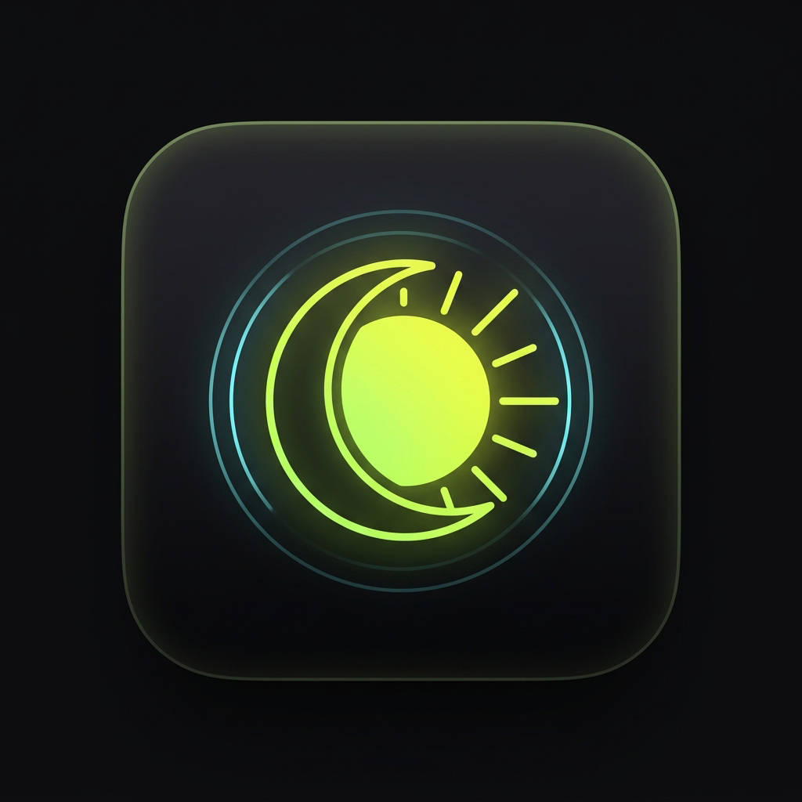

# cAlrmy — Premium AI Alarm & Wake-up Companion

<p align="center">
  
</p>

<p align="center">
  <b>The next-generation AI alarm app designed with a Linear-inspired glassmorphic aesthetic, 24 studio-quality sounds, and Google Gemini realistic voice wake-up escalation.</b>
</p>

---

## ✨ Features

- **Linear-Style Minimal Glassmorphism**:
  - Deep obsidian dark mode (`#07070A`, `#0E0E14`) & crisp light mode.
  - Ambient glowing gradients with dynamic floating blobs.
  - Custom analog sweep dial with Instrument Serif typography and digital clock.
  - Glowing 3D radial Orb with real-time breathing and audio ripple visualizers.

- **🎙️ Google Studio Realistic AI Voice**:
  - Powered by Google Gemini (`gemini-3.8-flash-lite-tts` & `gemini-3.5-flash-lite`).
  - Warm, human-like voice synthesis in 5 distinct personalities:
    - **Aoede**: Warm & natural female (Recommended)
    - **Kore**: Gentle & calm female
    - **Puck**: Cheerful & energetic male
    - **Charon**: Deep & relaxed male
    - **Fenrir**: Clear & confident male
  - Dynamic AI wake-up escalation: Starts warm, mentions your daily goal, and escalates if you snooze!

- **🎵 24 Studio-Quality Alarm Sounds**:
  - **Gentle Wake**: Zen Singing Bowl, Gentle Marimba, Dawn Harp, Sunrise Acoustic, Morning Dew Bells, Peaceful Kalimba.
  - **Nature & Ambient**: Forest Birds & Stream, Ocean Breeze, Bamboo Windchimes, Tibetan Temple Gong.
  - **Ambient Synth**: Celestial Pad, Golden Hour Chime, Lo-Fi Sunrise, Cosmic Awakening, Aurora Strings, Crystal Cascade, Quantum Vibe.
  - **Classic & Modern**: Digital Pulse, Classic Twin Bell, Retro Digital Beep, Radar Sonar, Energetic Synth, Arcade Rise, Tempo Escalation.

- **⏰ Complete Alarm Suite**:
  - Repeat days of the week (S, M, T, W, T, F, S)
  - Custom wake-up goals ("Study Physics at 6 AM", "Workout session")
  - Volume control (10% - 100%) and haptic vibration
  - 5-minute smart snooze & smooth dismiss
  - Sound preview before setting

- **🔒 Backend Secret Security**:
  - API keys are secured in `.env` and never exposed to the client or committed to GitHub.
  - Includes `.env.example` for easy configuration.

---

## 🚀 Building & Running

### Requirements
- Flutter SDK `>=3.3.0`
- Android SDK 34+
- Java 17

### Setup
```bash
# Clone the repository
git clone https://github.com/x4abu/calrmy.git
cd calrmy

# Copy environment template
cp .env.example .env
# Edit .env and insert your GEMINI_API_KEY

# Get dependencies
flutter pub get

# Run on Android device
flutter run

# Build release APK
flutter build apk --release
```

---

## 📦 APK Download
Pre-compiled release APKs are available directly in the [GitHub Releases](https://github.com/x4abu/calrmy/releases) section or GitHub Actions build artifacts.

---

## 📄 License
MIT License © 2026 Abu Saalim.
